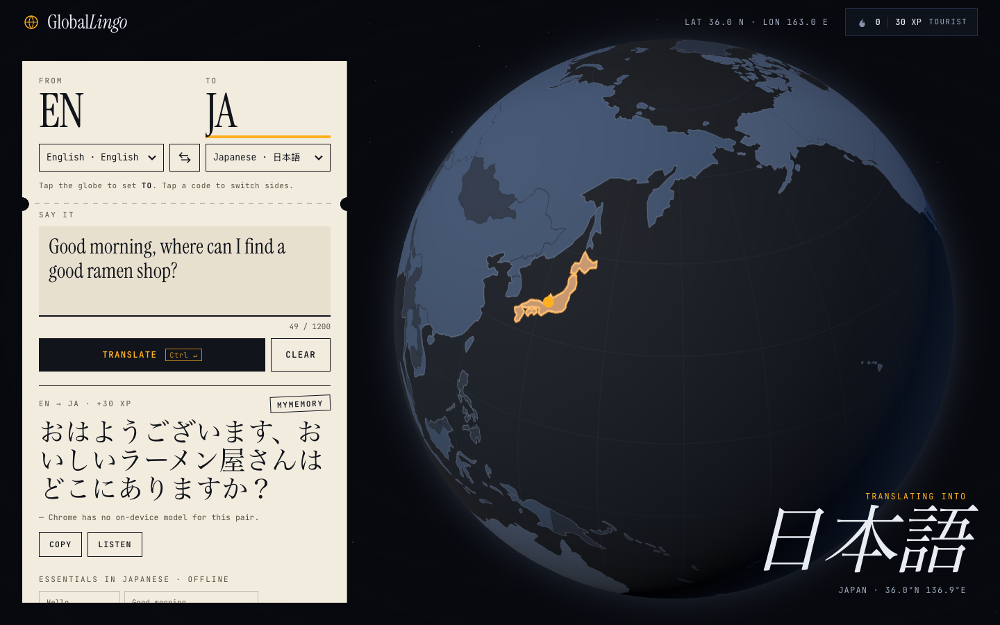
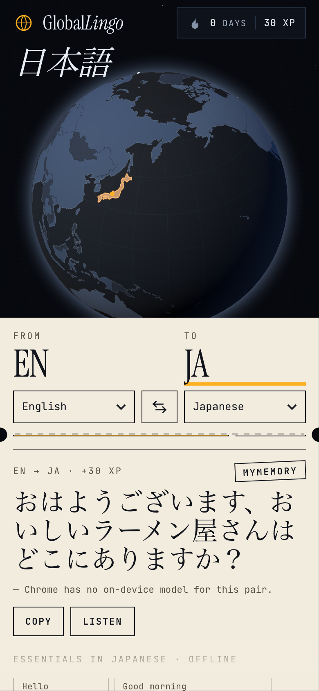
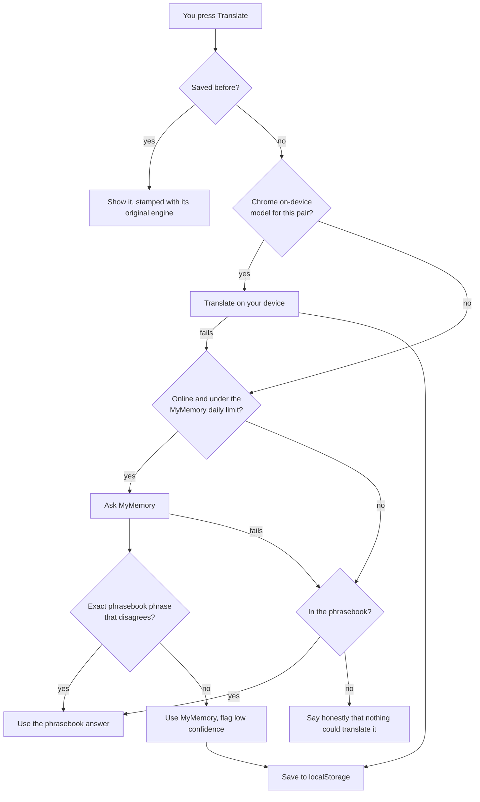

<p align="center">
  
</p>

# GlobalLingo

**Spin a globe, tap a country, and say it in its language.**

That's the whole idea. Type a sentence, pick where you're going, and GlobalLingo translates it. Every answer comes with a stamp that tells you *which engine* wrote it, so you always know how much to trust it. You also earn passport stamps, XP and streaks for the languages you visit.

**Live:** [global-lingo.vercel.app](https://global-lingo.vercel.app)

| Desktop | Mobile |
|---|---|
|  |  |

## What you can do

- **Tap the globe.** 29 languages, 110+ countries. Hover for a label, click to translate into that country's language; the globe flies there. Drag to spin, scroll or pinch to zoom, arrow keys when it's focused.
- **Translate fast.** Auto-detect the source language, swap sides, copy, or listen (uses a matching system voice, and says so if you don't have one).
- **See the engine.** Every result carries a stamp: `on-device`, `MyMemory` or `phrasebook`. Low-confidence answers get a warning instead of a confident face.
- **Collect a passport.** First time you translate into a language you get a stamp. Two translations a day keeps your streak. Ranks, milestones and a logbook live in the passport drawer. Haptics (`navigator.vibrate`) where supported, with an off switch.
- **Works without WebGL.** If 3D isn't available you get a flat, equally clickable map.
- **Accessible.** Keyboard everywhere, visible focus, WCAG-AA contrast, `prefers-reduced-motion` honoured (no spin, instant fly-to, no animations).

## How translation works

GlobalLingo tries three engines in order and stops at the first one that answers.

1. **On-device (Chrome).** If your browser has Chrome's built-in [Translator API](https://developer.chrome.com/docs/ai/translator-api), the text never leaves your device. The first time you use a language pair Chrome may download a small model; you'll see a progress bar.
2. **MyMemory.** A free public translation service (`api.mymemory.translated.net`, no key, about 5,000 characters a day). Long text is split into small pieces. If the daily limit is hit, GlobalLingo says so and moves on.
3. **Phrasebook.** A hand-checked list of 20 travel essentials ("Where is the bathroom?", "I need a doctor.") in every language. It works offline. If a phrase wasn't certain, it was left out instead of guessed.



Two details worth knowing:

- **The phrasebook outranks MyMemory on exact phrases.** MyMemory is crowd-sourced and its match score can be high for wrong answers (it once answered "Where is the train station?" in Arabic with an unrelated sentence at 0.99). When the input is *exactly* a curated phrase and the two answers differ, the curated one wins and the note says so.
- **Nothing sensitive leaves your browser except the text you translate**, and only to MyMemory if on-device isn't available. No API keys exist in this codebase. Saved translations, your passport and settings live in `localStorage`.

## Quick start

No install, no build. It's static HTML and ES modules.

```bash
git clone https://github.com/Waleee7/GlobalLingo.git
cd GlobalLingo
python3 -m http.server 7313
# open http://localhost:7313
```

Any static server works (`npx serve`, Vercel, GitHub Pages). It must be served over `http(s)`; opening `index.html` from disk blocks ES modules and `fetch`.

Run the logic tests (Node 20+, nothing to install):

```bash
node --test test/core.test.js
```

They cover the tier order, quota and offline fallbacks, MyMemory parsing and chunking, the cache, language detection, phrasebook integrity and the rewards/streak maths.

## Tech stack

| Piece | What |
|---|---|
| App | Vanilla HTML, CSS and ES modules. Zero build step. |
| Globe | [three.js 0.170.0](https://threejs.org), pinned through an import map from jsDelivr. Countries come from [world-atlas](https://github.com/topojson/world-atlas) 2.0.2 (110m, self-hosted in `src/data/`), painted to a canvas texture and wrapped on a sphere; clicks are resolved with a point-in-polygon test. |
| Translation | Chrome Translator + LanguageDetector APIs, MyMemory REST API, local phrasebook. |
| Type | Instrument Serif and JetBrains Mono, self-hosted (`src/fonts/`). |
| Storage | `localStorage`: translation cache (30 days, 250 entries), passport, preferences. |
| Tests | `node:test`, no dependencies. |

```
index.html             page + import map
src/css/main.css       design tokens and layout ("Night Flight")
src/js/main.js         UI wiring
src/js/globe.js        3D globe + flat fallback
src/js/translate-core.js  tiers, cache, chunking, detection (pure, tested)
src/js/engines.js      Chrome APIs and speech
src/js/phrasebook.js   offline phrases
src/js/rewards.js      XP, streaks, stamps (pure, tested)
test/core.test.js
```

## Honest limits

- Chrome's on-device Translator is desktop Chrome only, and supports fewer languages than the app lists. Other browsers use MyMemory or the phrasebook.
- MyMemory's free tier is small and its quality varies by language pair. That's why the engine stamp exists.
- "Listen" needs a voice for that language installed on your device.

---

Built by [Akinwale Dare](https://dare-os.vercel.app)
